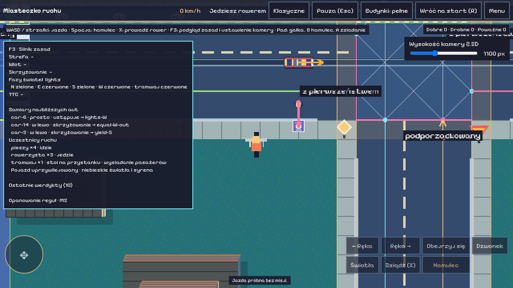
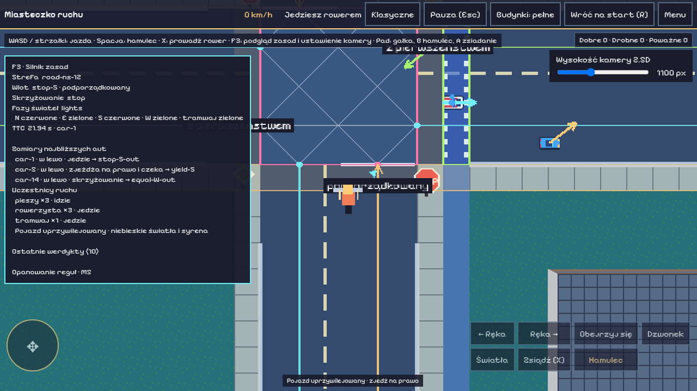

# 07 — Silnik zasad (Rule Engine)

To najważniejszy i najbardziej krytyczny moduł. Musi być **czystym TypeScriptem** (bez Phasera), deterministyczny i w 100% pokryty testami scenariuszowymi.

## 1. Przepływ danych
```
Tiled (.tmj) ──► WorldModel (strefy, LaneGraph, skrzyżowania, znaki, sygnalizatory)
                         │
                  TrafficParticipants ──► AgentState[] (ruch AI i hamowanie ochronne)
                                              │
Gra (Phaser) ──► RiderState ──────────────────┘ co tick
                         │
                 ZoneTracker ──► zdarzenia: enterZone/exitZone/approach/enterConflict/exitIntersection
                         │
                 IntersectionManager ──► kto ma pierwszeństwo, konflikty, time-to-conflict
                         │
                 Detectors (1 na ruleId) ──► Verdict[]
                         │
                 EventBus ──► ScoreSystem, MasterySystem, FeedbackUI, MissionSystem, Achievements, Replay
```

`TrafficSimulation` i silnik zasad pracują w TypeScripcie przy kroku 1/60 s i współdzielą jedną instancję `IntersectionManager` w scenie miasta. Symulacja wybiera początkowe odcinki i dozwolone skręty z ustalonego ziarna. Po wyjeździe za krawędź mapy ponownie wprowadza samochód tylko na wolny wlot graniczny. Scenariusze YAML nadal mogą podawać własne pozycje i manewry uczestników.

## 2. Model gracza (`RiderState`)
```ts
interface RiderState {
  id: string;
  pos: Vec2; heading: number; speed: number;   // m/s, kafel = 1.5 m
  mode: 'riding' | 'walking_bike';              // zsiadanie: klawisz X
  signal: 'none' | 'left' | 'right';            // ręka; auto-wyłączenie po manewrze lub 6 s
  shoulderCheck: { lastLeftAt: number; lastRightAt: number }; // „obejrzyj się”
  handsOnBar: 0 | 1 | 2;                        // 1 przy sygnalizowaniu, 0 = błąd MAN-09
  feetOnPedals: boolean;
  helmet: { worn: boolean; fastened: boolean };
  lights: { front: boolean; rear: boolean };
  equipment: { brake: boolean; bell: boolean; rearReflector: boolean; frontLamp: boolean; rearLamp: boolean };
  passenger: boolean;                           // zdarzenie „podwózka na bagażniku”
  phoneInHand: boolean;
  ageBand: 'under10' | '10to15' | '16plus';     // lokalny przedział, domyślnie 10–15
  supervisedChildId?: string;                  // jawna rola dorosłego opiekuna w scenariuszu
}
```

## 3. Kontekst środowiskowy
`EnvState { time: 'day'|'dusk'|'night', weather: 'clear'|'rain_light'|'rain_heavy'|'snow'|'wind_strong'|'fog'|'fog_dense'|'ice', visibilityLow: boolean }` — wpływa na WYP-04/05, MSC-04, GDZIE-04.

W GDZIE-04 wyjątek uruchamiają wyłącznie śnieg, silny wiatr, ulewa, gęsta mgła i gołoledź. Na dozwolonym chodniku nadal obowiązuje GDZIE-05. Przejezdność pobocza w GDZIE-03b wynika z danych mapy i sytuacji na poboczu.

## 4. Detektor — kontrakt
```ts
interface Detector {
  ruleId: string;                     // z content/przepisy.yaml
  subscribes: WorldEventType[];       // np. ['enterZone','tick','approachIntersection']
  evaluate(ev: WorldEvent, ctx: RuleContext): Verdict | null;
}
interface Verdict {
  ruleId: string;
  kind: 'good' | 'minor' | 'major';
  at: number;                         // czas symulacji
  pos: Vec2;
  evidence: Record<string, unknown>;  // np. { conflictWith: 'car_12', ttc: 1.3 }
  feedbackKey: string;                // i18n: linia Sierżant Oli
  highlight?: { signId?: string; zoneId?: string; agentId?: string }; // do stop-klatki
}
```
Ważność (`kind`) domyślnie z `przepisy.yaml` (`waga_bledu`), detektor może eskalować do `major`, gdy powstał konflikt (TTC < próg).

## 5. Kluczowe algorytmy

**Pierwszeństwo na skrzyżowaniu (IntersectionManager):**
1. Każdy wlot skrzyżowania ma `priorityClass` z danych Tiled: `main` (D-1/droga z pierwszeństwem), `minor` (A-7/B-20), `equal`, `signal` (sterowane fazą), `roundabout_in`, `roundabout_ring`.
2. Dla pary agentów A (gracz) i B: wyznacz zamierzony manewr (z kursu + sygnalizacji + trasy misji/AI: prosto/lewo/prawo/zawracanie) i punkt konfliktu z macierzy konfliktów skrzyżowania (prekomputowana z geometrii pasów).
3. Reguły rozstrzygania (w tej kolejności): polecenie policjanta (strefa kierowania ruchem) → sygnalizacja (faza + zielona strzałka = warunkowe) → znaki (main > minor) → tramwaj na skrzyżowaniu równorzędnym → prawa ręka → skręcający w lewo ustępuje jadącym z naprzeciwka prosto i w prawo → skręcający ustępuje pieszym/rowerzystom na przejściu na drodze, w którą wjeżdża.
4. Naruszenie pierwszeństwa = gracz wjeżdża w obszar konfliktu, gdy agent z pierwszeństwem ma `TTC < 2,0 s` (strojone w `balans.yaml`). `TTC < 1,0 s` lub hamowanie awaryjne AI → `major`.
5. Poprawne ustąpienie (gracz zwolnił/zatrzymał się przed obszarem konfliktu i przepuścił) → `good`.

**Samochody w M3a.** Macierz konfliktów korzysta z łączników grafu. Przed linią auto ocenia fazę S-1, możliwość zatrzymania przy zmianie na żółte, pełny postój na B-20 lub S-2 oraz kierunek strzałki. `IntersectionManager` sprawdza przecinające się manewry, pierwszeństwo i TTC. Auto wjeżdża, gdy jest miejsce na wyjeździe i skrzyżowanie jest wolne. Przy cyklu prawej ręki stojące auta kolejno przepuszczają najdłużej czekające auto, które ustępuje wyłącznie z tej reguły. Ruch respektuje zajętą zebrę oraz odstęp od poprzednika. Hamowanie ochronne uwzględnia pozycję i krótki przewidywany ruch gracza, a flaga `protectiveBrake` pozwala ocenić wagę wymuszenia.

**Uczestnicy ruchu w M3b.** `TrafficParticipants` aktualizuje pieszych, rowerzystów, tramwaj, pasażera i pojazd uprzywilejowany w tej samej pętli 1/60 s. Silnik zasad dostaje pozycje aktywnych uczestników po aktualizacji ruchu. Mapa Tiled określa trasy, sygnały, przystanek i czas ponownego wjazdu.

- Piesi idą po chodniku i zajmują przejście dopiero po sprawdzeniu sygnału oraz zwolnieniu przejścia przez pojazdy. Kończą rozpoczęte przejście po zmianie sygnału. Przy zebrze bez sygnalizacji samochody ustępują pieszemu wchodzącemu na przejście również w fazie oczekiwania na jego zwolnienie. Sąsiadujące zebra i przejazd rowerowy mogą wskazać wspólny obszar zatrzymania pojazdów.
- Rowerzyści jadą po DDR i pasie w kierunku wyznaczonym na mapie (GDZIE-01, GDZIE-02). Zwalniają przed przejazdem i stosują się do sygnalizatora rowerowego (PIER-05, SYG-02). Na jezdni jadą przy prawej krawędzi (GDZIE-03) i dzielą z autami odstępy, sygnalizację oraz pierwszeństwo. Trasa jezdnią jest dopuszczona wyłącznie bez przypisanej infrastruktury rowerowej i zakazu.
- Tramwaj jedzie po polilinii Tiled i dostaje pierwszeństwo na równorzędnym przez `IntersectionManager` (PIER-09). Sygnalizacja i znaki są rozpatrywane wcześniej. Tramwaj zajmuje skrzyżowanie do zjazdu tyłu pojazdu i hamuje ochronnie przed graczem. Na przystanku bez wysepki samochody pozostawiają miejsce na wysiadanie. Tramwaj odjeżdża po przejściu pasażera przez jezdnię na chodnik (MSC-02).
- Zdarzenie pojazdu uprzywilejowanego uruchamia niebieskie światła, syrenę i wskazanie kierunku (PIER-07). Samochody w kierunku jego jazdy zjeżdżają w prawo i czekają, jeśli mają miejsce. Pojazd uprzywilejowany przepuszcza uczestników kończących przejazd przez skrzyżowanie, a na zablokowanej trasie hamuje.

**Sygnalizowanie zmiany kierunku (MAN-01):**
- Manewr = zmiana kursu > 45° na skrzyżowaniu, zjazd z drogi, zmiana pasa, omijanie z przesunięciem bocznym > 1 m.
- `good`: `signal` zgodny z kierunkiem aktywny ≥ 1,5 s przed wjazdem w obszar manewru (dozwolone opuszczenie ręki w trakcie samego skrętu).
- `minor`: brak lub zły kierunek.

**Obejrzenie się (MAN-03/MAN-07):** przed skrętem w lewo i ruszeniem od prawej krawędzi: `shoulderCheck.lastLeftAt` w oknie 3 s przed manewrem → `good` (bonus). Brak = nie błąd, ale jeśli z tyłu był pojazd w martwym polu → `minor` + pokazanie go w stop-klatce. W Miasteczku przycisk „Obejrzyj się” zapisuje czas ruchu głową. Przed skrętem silnik zapamiętuje spojrzenie i obecność pojazdu w martwym polu, gdy gracz wjeżdża na skrzyżowanie. Werdykt pojawia się po wykonaniu lewego skrętu.

**Gdzie jechać (GDZIE-*):**
- ZoneTracker zna strefę pod kołami. Reguła GDZIE-01: jeśli gracz jedzie `roadway` równolegle do istniejącego `bike_path` lub `bike_lane` przypisanego do tego kierunku (atrybut `parallelBikeInfra` pasa w Tiled) przez > 3 s → `minor`.
- GDZIE-04 (chodnik): `sidewalk` + `mode='riding'` → sprawdź wyjątki: jawna opieka dorosłego nad jadącym dzieckiem <10 lat; `weather` ∈ {rain_heavy, snow, wind_strong, fog_dense, ice}; atrybuty chodnika `width_m ≥ 2` i sąsiednia jezdnia `speedLimit > 50` i brak DDR/pasa. Brak wyjątku → `minor`. Z wyjątkiem → sprawdzaj GDZIE-05 (prędkość ≤ 2,5 m/s przy pieszych w promieniu 3 m, ustępowanie pieszym).
- GDZIE-06: wjazd na `crossing.pedestrian` w trybie `riding` → `minor`; jeśli pieszy na przejściu w promieniu 4 m → `major`. Przejście w trybie `walking_bike` → `good`.

**Sygnalizacja świetlna (SYG-01):** przekroczenie linii zatrzymania (P-12 / linia z danych) przy czerwonym → `major`; przy żółtym, gdy gracz miał dość miejsca na bezpieczne zatrzymanie (droga hamowania < odległość do linii) → `minor`. Zatrzymanie przed linią na czerwonym → `good`.

**STOP (ZNAK-STOP):** wymagane `speed < 0,1 m/s` przez ≥ 0,3 s w strefie 0–3 m przed linią zatrzymania. Brak → `minor` (nawet bez konfliktu); z konfliktem → `major`.

**Przejazd kolejowy (MSC-01).** Wjazd przy migających czerwonych światłach, ruchu zapór albo opuszczonych zaporach daje `major`, tak samo jak postój na torach przez co najmniej 0,5 s. Zmiana kolejności względem jadącego w tym samym kierunku pojazdu w ostatnich 100 m przed przejazdem daje `minor`. Mapa określa długości faz w polach `open_s`, `lowering_s`, `closed_s`, `raising_s` i opcjonalnym `offset_s`. Samochody AI odczytują tę samą fazę co detektor i światła na mapie.

**Ocena pierwszeństwa w M3c, część 1.** PIER-03 wykorzystuje geometrię manewrów i TTC. Gdy gracz nie ma przypisanego manewru w scenariuszu, silnik zachowuje dowody z wjazdu i sprawdza faktyczny skręt. PIER-04 obserwuje pieszych i rowerzystów na oznakowanym przejściu lub przejeździe na drodze wyjazdowej. PIER-05 ocenia ryzyko podczas wjazdu na przejazd rowerowy. PIER-08 przyznaje pierwszeństwo pojazdowi na rondzie przy wlocie z A-7. PIER-09 korzysta z pierwszeństwa tramwaju na równorzędnym po sprawdzeniu świateł i znaków. Feedback PIER-04, PIER-05 i PIER-09 opisuje bezpieczne zachowanie w ćwiczeniu, a ich flagi do konsultacji są zachowane.

**Zebra na wysepkę.** Na przejściu oznaczonym `tramPlatform` PIER-10 ocenia ustąpienie pieszym, którzy wchodzą lub idą przez pas rowerzysty. Przystanek z wysepką i przystanek bez wysepki używają odrębnych kontroli ruchu.

**Ustępowanie poza skrzyżowaniem.** PIER-06 sprawdza włączanie się po postoju przy krawędzi i przy wyjazdach zaznaczonych warstwą `driveways`; kierunek wyjazdu jest zapisany w `direction`. MSC-03 wymaga postoju przed przecięciem chodnika i przepuszczenia uczestników ruchu. MSC-02 korzysta z aktywnego przystanku bez wysepki zgłaszanego przez tramwaj. PIER-07 ocenia zjazd w prawo i hamowanie ochronne pojazdu nadjeżdżającego z tyłu z aktywnymi sygnałami.

**Stan roweru i nawyki.** MAN-06 mierzy boczny odstęp od obrysów pojazdów w warstwie `parked_cars`. Światła oceniają WYP-04, WYP-05 i MSC-04. Pora dnia i pogoda wynikają z danych misji, a w wolnej jeździe zmrok ustawia także parametr mapy `dusk_at_s`. Mnożniki hamowania z `balans.yaml` stosują się do jazdy i oceny drogi hamowania. WYP-06 przyznaje raz na przejazd premię za kamizelkę podczas jazdy po ciemku z obiema lampkami. MAN-09, MAN-10 i MAN-11 odczytują stan rąk i nóg, przytrzymanie pojazdu, pasażera na jednoosobowym rowerze i telefon w ręku. Scenariusze mogą podać te stany bezpośrednio. Zdarzenia z propozycją podwózki i telefonem będą dostarczane przez misje.

**Jazda i dostęp w M3c, część 2.** GDZIE-02 sprawdza kierunek oznaczonego pasa, a GDZIE-01 nadal ocenia wybór infrastruktury przypisanej do kierunku. GDZIE-03 ocenia jazdę na prostym, czytelnym obrysie jezdni. Wykrywa jazdę ponad 2 m od prawej krawędzi po sekundzie obserwacji poza skrzyżowaniem, przejściem i rozpoznanym manewrem. Próg jest tolerancją ćwiczenia. GDZIE-03b używa pary `lanes.parallelShoulder` i `zones.shoulderUsable`, z uwzględnieniem kierunku, ciągłości pobocza, pogody i uczestników na poboczu. Pierwszeństwo ma przypisana droga lub pas dla rowerów. GDZIE-07 ocenia limit 20 km/h i konflikt z pieszym w obrębie `living_zone`, również gdy strefa pokrywa jezdnię. Przy jeździe obok siebie GDZIE-08 wykrywa hamowanie ochronne pojazdu jadącego za parą. `shared_path` obejmuje wspólną drogę, a opcjonalne `sharedSide: pedestrian | bike` oznacza wydzieloną część. GDZIE-11 sprawdza wybór części i zachowanie wobec pieszych.

Znaki B-1, B-2 i B-9 wskazują objęty odcinek przez `signs.affects` (identyfikator strefy lub wlotu). B-1 dotyczy całego oznaczonego odcinka w obu kierunkach. B-2 i B-9 korzystają z `facing`, a `exceptBicycles: true` na B-1 lub B-2 opisuje wyjątek dla roweru gracza. GDZIE-09 odczytuje odcinek `no_bikes`, również bez osobnego znaku. ZNAK-B9 obsługuje znak wskazujący odcinek bez takiej strefy. ZNAK-A7 wykorzystuje macierz konfliktów i działa również na wlocie, na którym pierwszeństwo ustalono tylko za pomocą A-7, bez osobnej klasy drogi głównej.

**Światła i kierowanie ruchem.** SYG-02 sprawdza wjazd na przejazd rowerowy z przypisanym `crossing_signals` na czerwonym. Na tym torze jazdy obowiązuje faza dla roweru. Sygnalizacja jezdni nadal obowiązuje na sąsiednim pasie. SYG-03 wykorzystuje jawne polecenia `EnvState.officerOrders` (identyfikator wlotu → `stop` lub `go`). Polecenie nadpisuje sygnały i znaki na danym wlocie, a z tego samego rozstrzygnięcia korzysta AI. Misje dostarczą polecenia oraz animację osoby kierującej ruchem.

**Manewry.** MAN-02 obserwuje prawy skręt od wjazdu do wyjazdu i mierzy odległość od krawędzi na obu końcach. MAN-04, MAN-05 i MAN-12 korzystają ze zmiany kolejności względem tego samego uczestnika lub zaparkowanego auta. Uwzględniają zmianę toru, wcześniejsze spojrzenie i sygnał, odstęp, stronę oraz ruch drugiego pojazdu. Przy wyprzedzaniu z prawej dymek ostrzega przed małym odstępem lub możliwym skrętem pojazdu w prawo. Na niekierowanym przejściu, przejeździe i bezpośrednio przed nimi oraz na niekierowanym skrzyżowaniu poza rondem MAN-12 wykrywa wyprzedzenie. Wykrywa też ominięcie pojazdu, który zatrzymał się w celu ustąpienia pieszemu. Przy przejeździe kolejowym wyprzedzenie ocenia MSC-01. MAN-08 szacuje drogę zatrzymania odpowiednio do pogody. Bierze pod uwagę pieszego na torze jazdy, zajęty wyjazd oraz oznaczoną nierówną nawierzchnię (`surface: rough`).

## 6. Dobre nawyki (werdykty `good`) — lista obowiązkowa
Werdykt `good` wymaga zachowania z tej listy oraz pola `dobry_nawyk` przy regule.

Zasygnalizowany manewr · ustąpione pierwszeństwo · zatrzymanie na STOP · zatrzymanie na czerwonym · przeprowadzenie roweru przez przejście · obejrzenie się przed manewrem · włączenie świateł o zmroku (raz na misję) · zachowanie odstępu od zaparkowanych aut (> 1 m) · zjazd na prawo przed pojazdem uprzywilejowanym · przepuszczenie pieszych na przystanku bez wysepki lub na zebrze do wysepki · wybór DDR zamiast jezdni · zwolnienie na chodniku przy pieszych · odebranie telefonu dopiero po zatrzymaniu.

MAN-04 daje pochwałę za odpowiednio wczesne obejrzenie się i zasygnalizowanie zmiany toru w lewo przed bezpiecznym ominięciem lub wyprzedzeniem.

Przepuszczenie tramwaju, przepuszczenie pasażera oraz ułatwienie przejazdu pojazdowi uprzywilejowanemu są w M3b zachowaniami symulacji. Detektory PIER-07, PIER-09 i MSC-02 wykorzystują te same stany uczestników w M3c.

## 7. Stop-klatka i feedback

Gdy błąd kończy próbę w kampanii, gra wstrzymuje jazdę, AI, zdarzenia i zegar, po czym pokazuje ostatnią klatkę, przyczynę i podświetlenie z werdyktu. Gdy jazdę można kontynuować, stop-klatka „UPS!” pokazuje spowolnioną końcówkę zdarzenia, a następnie zwiększa zoom do ×1,5. Obrys znaku, strefy lub uczestnika ruchu pulsuje z częstotliwością 2 Hz. Przy ograniczonym ruchu gra pomija spowolnienie i zoom oraz wyświetla stały obrys.

Sierżant Ola podaje jedno zdanie `feedback` z `content/przepisy.yaml` wskazane przez `feedbackKey`. Dymek mieści najwyżej 140 znaków. „Powtórka” odtwarza historię w zwykłym tempie i ponownie zatrzymuje się na zdarzeniu. W dialogu „UPS!” przycisk „Jeszcze raz” przenosi do checkpointu misji lub startu w wolnej jeździe, a „Rozumiem” wznawia jazdę po drobnym błędzie. Po porażce „Jeszcze raz od początku” uruchamia nową próbę misji.

`ReplayBuffer` jest niezależny od Phasera. Wstępnie przydziela 301 próbek na 300 odstępów po 1/60 s. Zapisuje pozycję, kierunek i prędkość gracza i agentów oraz stan potrzebny do prezentacji, w tym aktywność agentów, światła, akcje gracza i obiekty zdarzeń. Renderer czyta próbki w kolejności czasu i podczas powtórki pomija krok symulacji. Historia krótsza niż 5 s odtwarza dostępny odcinek. Przeniesienie roweru zaczyna nową historię w miejscu odrodzenia.

Powtórkę można uruchomić z klawiatury lub dotykiem. Na padzie A uruchamia lub zatrzymuje powtórkę, B zamyka lekcję, a X wybiera „Jeszcze raz”. Na ekranie nieudanej próby A ponawia misję, a B wraca do menu.

## 8. Testy scenariuszowe (`tests/rules/*.yaml`)

```yaml
map: maps/miasteczko.tmj
scenarios:
  - name: prawa ręka — gracz nie ustępuje autu z prawej
    player: { x: 528, y: 723, heading: -90, speed: 4 }
    agents:
      - { id: car, kind: car, x: 590, y: 560, heading: 180, speed: 4, laneId: equal-E }
    inputs: [{ t: 0.5, y: 695 }]
    expect: { PIER-01: [major], MAN-01: [] }
```

W M2 scenariusz podaje próbki wejściowe silnika. Pozycje w YAML odnoszą się do pikseli Tiled, prędkości są w m/s, a kurs podajemy w stopniach zgodnie z osiami ekranu. Runner interpoluje pozycje z krokiem 1/60 s, a pozostałe pola utrzymuje do następnej próbki. Tablica przy identyfikatorze określa wszystkie oczekiwane wagi w kolejności emisji. Pusta tablica wymaga braku werdyktu tej reguły. Osobny test powtarza również log sterowania modelem jazdy.

Dla każdej reguły testujemy `good`, `minor` i `major` tam, gdzie dana waga istnieje, oraz warunek graniczny. Przypadki i uruchomienie opisuje [README testów](../tests/rules/README.md).

Scenariusze [M3c, część 1](../tests/rules/m3c.yaml) uzupełniają format o próbki położenia i stanu uczestników, wymuszone stany zapór oraz sprawdzenie wybranych dowodów werdyktu. Część scenariuszy ronda zmienia klasy wlotów i oznakowanie w pliku YAML.

Scenariusze [M3c, część 2](../tests/rules/m3c-part2.yaml) korzystają z tej samej mapy bazowej i mogą dodać obiekty Tiled do istniejących warstw. Sprawdzają m.in. warunki graniczne, hierarchię wlotów, rozpoznanie manewrów i brak podwójnego werdyktu.

Scenariusze [M3b](../tests/sim/m3b.yaml) uruchamiają rzeczywistą symulację. Sprawdzają pierwszeństwo tramwaju, jego reakcję na zablokowanie toru i sygnalizację oraz zatrzymanie pojazdu uprzywilejowanego przed graczem i wznowienie przejazdu po zjechaniu gracza na prawo. Test dziesięciu minut obejmuje wszystkie typy uczestników, postęp każdego z nich, odstępy, wysiadanie i ustępowanie pojazdowi z sygnałami.

## 9. Debug overlay (F3)
Nakładka pokazuje strefy, skierowane polilinie, węzły i dozwolone relacje skrętu. Strzałki nad autami pokazują zamiar jazdy, a panel opisuje manewr, docelowy pas i stan najbliższych aut. Nadal widać klasy pierwszeństwa wlotów, fazy świateł, TTC i 10 ostatnich werdyktów. Wyniki opanowania reguł są planowane od M5.

Panel M3b pokazuje również stan pieszych, rowerzystów, tramwaju z wysiadaniem i zdarzenia uprzywilejowanego. Strzałki nad uczestnikami wskazują kierunek ich ruchu.





## 10. Reguły `quiz-only`
Pole `detektor` w `przepisy.yaml` jest obowiązkowe. `sim` wymaga detektora wykonanego przez silnik i sprawdzanego scenariuszami YAML. `quiz-only` oznacza pytanie teoretyczne, a `scenka`, `garaz` i `plac` wskazują osobne tryby ćwiczeń.

MSC-05 jest oznaczone jako `quiz-only`, ponieważ ocenienie liczebności i odległości pomiędzy całymi kolumnami poza oskryptowaną misją wymaga danych, których ruch swobodny nie posiada. Pierwsza pomoc pozostaje w scence. KASK-01 zachowuje ochronny werdykt za jazdę bez kasku dla graczy poniżej 16 lat. Założenie kasku i opcjonalnych odblasków nie daje punktów za nawyki jazdy z §6.

GDZIE-10 jest oznaczone jako `quiz-only`. Swobodna jazda nie daje graczowi roli dziecka poniżej 10 lat pod opieką konkretnego dorosłego. Sytuację z Frankiem można odtworzyć w oskryptowanej eskorcie. GDZIE-04 nadal obsługuje odwrotną perspektywę, gdy scenariusz jawnie przypisuje graczowi rolę dorosłego opiekuna.

Test pokrycia wymaga implementacji i co najmniej trzech scenariuszy dla każdej reguły `sim`, w tym scenariusza naruszenia oraz zachowania neutralnego lub poprawnego. KASK-01 ma przypisany garaż i sprawdzany scenariuszami obowiązek podczas jazdy.

## 11. Priorytety werdyktów i deduplikacja

Epizod wiąże kandydatów opisujących jedno zdarzenie. Wygrywa najpierw waga (`major` > `minor` > `good`), potem kolejność w tabeli. Osobne zdarzenia, np. brak kasku i niezasygnalizowany skręt, mają osobne werdykty.

| Zdarzenie | Przy równej wadze (od najwyższego priorytetu) | Klucz epizodu |
| --- | --- | --- |
| Wjazd na odcinek z zakazem B-9 | GDZIE-09 → ZNAK-B9 | Gracz + odcinek zakazu |
| Wymuszenie przy wyjeździe z posesji | MSC-03 → PIER-06 | Gracz + wyjazd |
| Jazda bez wymaganych świateł | MSC-04 → WYP-04 → WYP-05 | Gracz + ciągła jazda w warunkach ograniczonej widoczności |
| Wjazd z wlotu podporządkowanego | ZNAK-STOP → PIER-02 → ZNAK-A7 | Gracz + wlot + pojedynczy przejazd |
| Wjazd przy aktywnej sygnalizacji | Na torze przejazdu rowerowego SYG-02, na jezdni SYG-01 lub ZNAK-S2; polecenie kierującego ruchem daje pierwszeństwo SYG-03 | Gracz + linia wjazdu + pojedynczy przejazd |
| Ominięcie lub wyprzedzenie | MAN-12 → MAN-05 → MAN-04; wyprzedzenie przed przejazdem kolejowym ocenia MSC-01 | Gracz + mijany pojazd + pojedynczy manewr |

STOP bez konfliktu daje `minor` za pominięcie zatrzymania albo `good` po postoju. Gdy gracz zatrzymał się prawidłowo i następnie wymusił pierwszeństwo, werdykt PIER-02 zastępuje pochwałę za STOP. Gdy pominął postój i jednocześnie wymusił pierwszeństwo, STOP przejmuje wagę i dowód konfliktu. Brak jednej lampki daje werdykt WYP-04 lub WYP-05, a brak obu daje jeden werdykt MSC-04. Włączenie świateł przy ograniczonej widoczności może dać jeden bonus w przebiegu.

Ocena wjazdu odbywa się przy przekroczeniu skierowanej linii wlotu. W epizodach strefowych tolerancja wyjścia wynosi 0,25 s. Krótki powrót do tej samej strefy podtrzymuje stan epizodu, a czas poza strefą nie liczy się do progu naruszenia. Po wjeździe na skrzyżowanie epizod wygasa po 0,25 s poza obszarem albo po wycofaniu ponad 3 m przed linię. Bezpośredni przejazd po jezdni przez zebrę wzdłuż ruchu pojazdów nie jest użyciem przejścia.

### Wagi i progi M2

- KASK-01 daje `major` przy jeździe bez zapiętego kasku w przedziale poniżej 16 lat. Prowadzenie roweru i jazda bez kasku w przedziale 16+ nie emitują naruszenia.
- GDZIE-01 i GDZIE-04 mają wyłącznie wagę błędu `minor`. Próg jezdni równoległej to ściśle więcej niż 3 s, tylko w przypisanym kierunku. Legalny wyjątek jest neutralny dla GDZIE-04 i nie emituje werdyktu. Zachowanie wobec pieszych nadal ocenia GDZIE-05. Werdykt `good` jest zarezerwowany dla reguł z `dobry_nawyk`.
- GDZIE-05 przy pieszym w promieniu 3 m daje `minor` za przekroczenie 2,5 m/s lub utrudnienie przejścia. Zagrożenie przy TTC < 1 s lub hamowanie ochronne daje `major`; sam wysoki odczyt prędkości bez konfliktu nie eskaluje.
- Dla GDZIE-06 sprawdzamy obecność pieszego przy wjeździe podczas korzystania z zebry. Przejazd rowerowy należy do osobnej kategorii.
- PIER-01/02 wykorzystują progi 2 s i 1 s z balansu. Równość z progiem nie zwiększa wagi. `good` wymaga przepuszczenia rzeczywistego konfliktowego uczestnika po zwolnieniu lub postoju. Trasy bez wspólnego punktu konfliktu nie powodują werdyktu.
- SYG-01 ocenia możliwość bezpiecznego postoju przy początku żółtego, a nie tuż przy linii. S-2 jest odrębnym sygnałem warunkowym wymagającym postoju i ustąpienia. MAN-01 ma wyłącznie wagę błędu `minor`; dokładnie 1,5 s zgodnego sygnału wystarcza.
